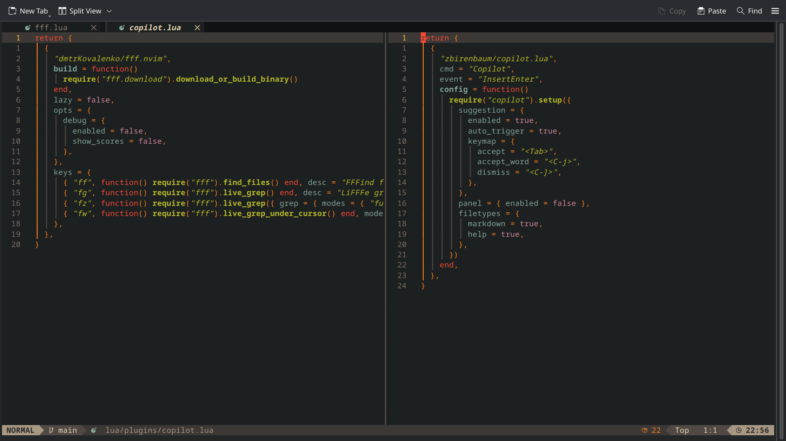

# Ma configuration LazyVim

Ma configuration personnelle de Neovim, basée sur LazyVim, avec le thème Gruvbox et des raccourcis inspirés des éditeurs classiques.



## Fonctionnalités

- **Gruvbox** avec un contraste fort.
- **GitHub Copilot** : suggestions automatiques, acceptation avec `Tab` et acceptation par mot avec `Ctrl+j`.
- **OpenCode** : interaction avec un assistant depuis Neovim.
- **fff.nvim** : recherche de fichiers et recherche dans leur contenu.
- Extras LazyVim pour **Ruby** et **Rust**.
- Presse-papier système, navigation entre buffers et raccourcis de sélection, annulation et rétablissement.
- Configuration Supermaven incluse, désactivée par défaut.

## Installation

Configuration utilisée avec Neovim **0.12.5**. Prévoir Git, une police Nerd Font pour les icônes et les outils nécessaires aux langages utilisés. Le presse-papier système nécessite un fournisseur adapté au système, par exemple `wl-clipboard` sous Wayland ou `xclip` sous X11.

Pour conserver une configuration existante, la déplacer avant de cloner :

```sh
config_dir="${XDG_CONFIG_HOME:-$HOME/.config}"
if [ -e "$config_dir/nvim" ]; then
  mv "$config_dir/nvim" "$config_dir/nvim.backup-$(date +%Y%m%d-%H%M%S)"
fi
git clone https://github.com/Yusufibin/lazyvim-config.git "$config_dir/nvim"
nvim
```

Au premier démarrage, laisser lazy.nvim installer les plugins. Le fichier `lazy-lock.json` conserve les révisions des plugins ; `:Lazy restore` permet de les restaurer. Utiliser `:checkhealth` pour vérifier les dépendances de la machine.

Copilot nécessite une connexion personnelle avec `:Copilot auth`. L’intégration OpenCode nécessite le programme `opencode` installé et configuré séparément. Aucun identifiant de connexion n’est fourni dans ce dépôt.

## Raccourcis personnalisés

| Raccourci | Action |
| --- | --- |
| `ff` | Rechercher un fichier |
| `fg` | Rechercher dans le contenu des fichiers |
| `fz` | Recherche approximative dans le contenu |
| `fw` | Rechercher le mot sous le curseur |
| `Ctrl+a` | Tout sélectionner, en mode normal ou insertion |
| `Ctrl+z` | Annuler, en mode normal ou insertion |
| `Ctrl+y` | Rétablir, en mode normal |
| `Ctrl+c` / `Ctrl+x` | Copier / couper la sélection |
| `Ctrl+v` | Coller depuis le presse-papier système |
| `Ctrl+←` / `Ctrl+→` | Buffer précédent / suivant |
| `<leader>oa` | Poser une question à OpenCode |
| `<leader>os` | Ouvrir la sélection OpenCode |

Ces raccourcis remplacent certaines commandes Vim habituelles. `<leader>` correspond à la touche configurée par LazyVim, généralement Espace.

## Organisation

- `init.lua` : point d’entrée.
- `lua/config/` : chargement de lazy.nvim, options et raccourcis.
- `lua/plugins/` : plugins et personnalisations.
- `lazyvim.json` : extras activés.
- `lazy-lock.json` : révisions des plugins.
- `lua/plugins/example.lua` : exemples du starter, inactifs.

## Licence

Licence Apache 2.0, conservée depuis le starter LazyVim. Voir [LICENSE](LICENSE).
